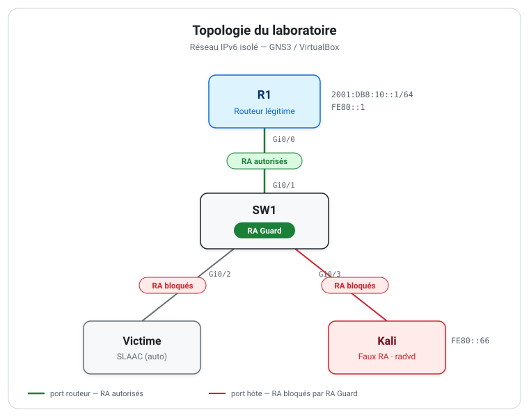

# TP IPv6 — RA, SLAAC & RA Guard

Reproduction en laboratoire d'une attaque par faux *Router Advertisement* sur IPv6, et sa mitigation par **RA Guard**. Tout se déroule dans un environnement GNS3 / VirtualBox isolé.

<sub>Module « Protocoles de sécurité et cryptanalyse » — EMSI</sub>

<p align="center">
  
</p>

## Contexte

En IPv6, un hôte s'auto-configure en écoutant les *Router Advertisements* (RA) du routeur : c'est SLAAC. Comme rien n'authentifie ces messages, n'importe quelle machine du lien peut en émettre. Le TP suit trois temps :

1. **Normal** — observer l'auto-configuration `RS → RA → SLAAC` depuis R1.
2. **Attaque** — émettre un faux RA depuis Kali (`radvd`) et constater son effet sur la victime.
3. **Défense** — appliquer RA Guard sur le switch, puis vérifier que le faux RA est bloqué.

L'attaque opère en couche 3 (ICMPv6 / NDP) ; la protection, elle, est appliquée sur le switch, en couche 2.

## Machines

| Hôte | Rôle | Plateforme |
|------|------|-----------|
| **R1** | Routeur légitime, annonce `2001:DB8:10::/64` | Cisco IOSv / IOU |
| **SW1** | Switch, applique RA Guard | Cisco IOS/IOS XE (First-Hop Security) |
| **Victime** | Client auto-configuré par SLAAC | Ubuntu ou Windows |
| **Kali** | Émetteur du faux RA | Kali Linux |

## Organisation du dépôt

```
docs/        fondations IPv6, installation, déroulé des exercices, questions
configs/     configurations prêtes à l'emploi
  ├─ r1.cfg              routeur légitime
  ├─ sw1-raguard.cfg     politique RA Guard
  └─ radvd/              scénarios d'attaque (faux préfixe, faux routeur)
topology/    schéma de la topologie
```

## Mise en œuvre

1. Monter l'environnement — [`docs/01-installation.md`](docs/01-installation.md)
2. Configurer R1 et observer le SLAAC normal — [`configs/r1.cfg`](configs/r1.cfg)
3. Lancer l'attaque depuis Kali — [`configs/radvd/`](configs/radvd)
4. Appliquer RA Guard — [`configs/sw1-raguard.cfg`](configs/sw1-raguard.cfg)
5. Vérifier le blocage et répondre aux questions — [`docs/02-exercices.md`](docs/02-exercices.md), [`docs/03-questions-reponses.md`](docs/03-questions-reponses.md)

Les bases théoriques (couches, NDP, SLAAC, DHCPv6) sont dans [`docs/00-fondations.md`](docs/00-fondations.md).

## Vérification

Capture sur le lien de la victime, filtre Wireshark `icmpv6.type == 134` :

- avant RA Guard — deux RA visibles, `FE80::1` (R1) **et** `FE80::66` (Kali) ;
- après RA Guard — seul le RA de `FE80::1` subsiste ; celui de Kali a disparu.

C'est la disparition du RA de Kali, le RA légitime restant intact, qui prouve l'efficacité de la protection.

## Avertissement

Ce laboratoire injecte de faux Router Advertisements. Il ne doit être exécuté que dans l'environnement isolé décrit ici. Émettre de faux RA sur un réseau réel ou partagé est illégal.
